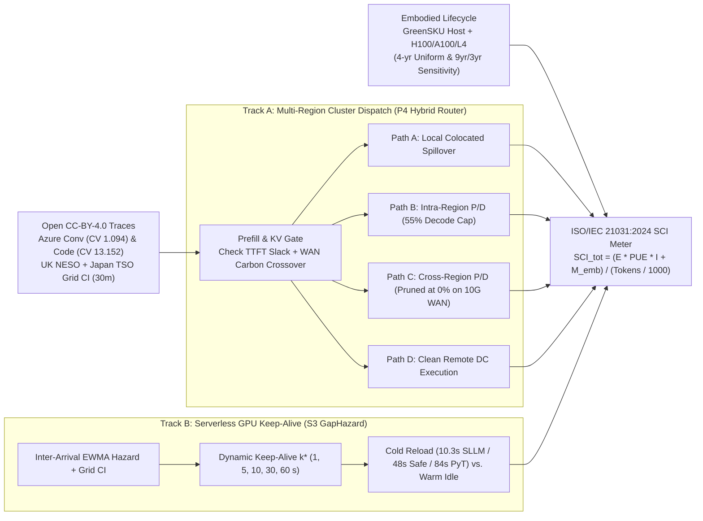
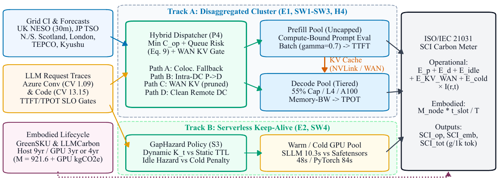
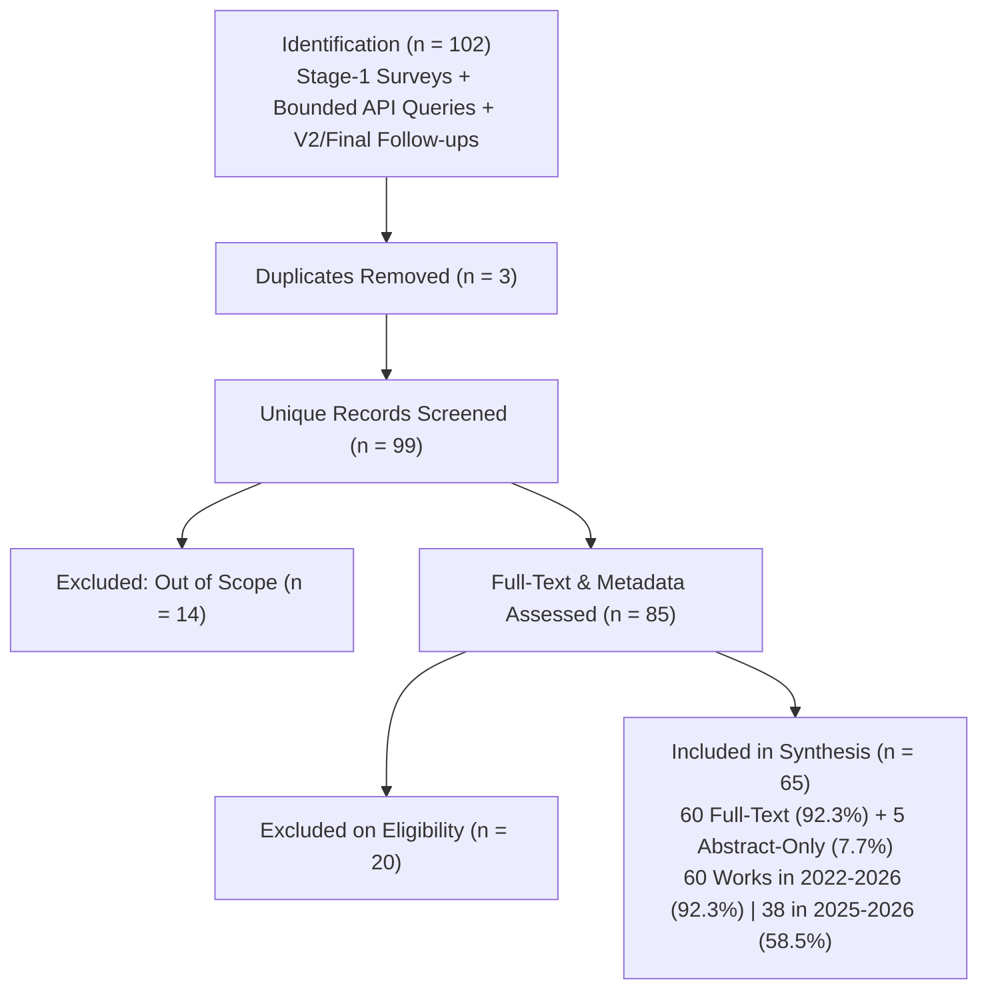
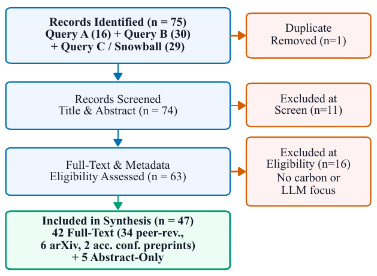
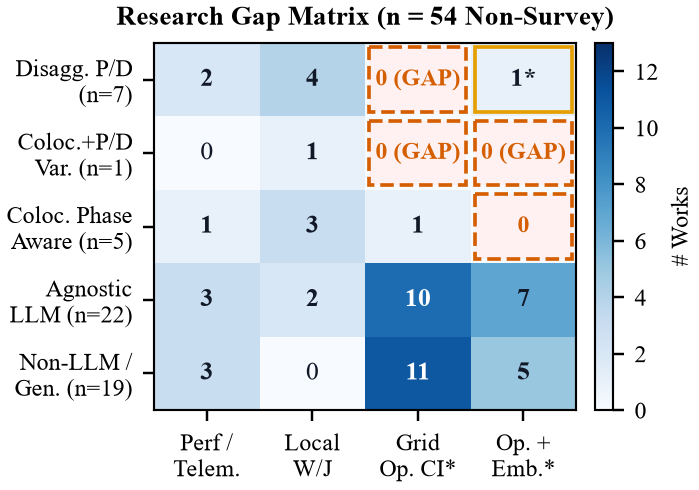
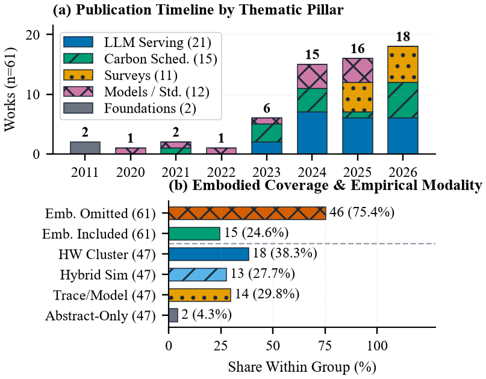
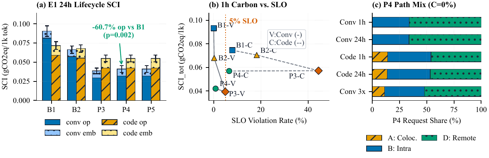
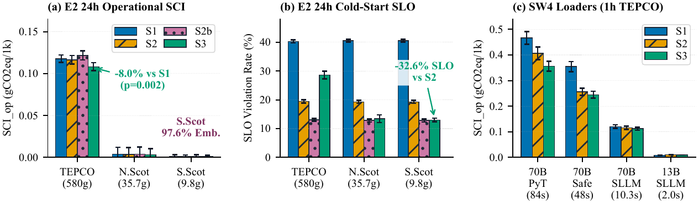
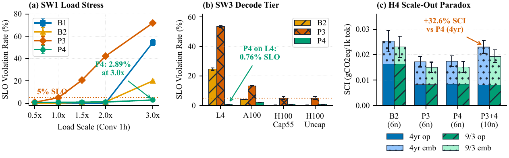
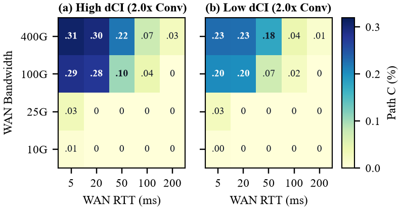

# Carbon-Aware Scheduling for Phase-Disaggregated LLM Inference in Cloud and Serverless Platforms: Review and Simulation

[](https://orcid.org/0009-0004-3968-4857)
[](./LICENSE)
[](https://creativecommons.org/licenses/by/4.0/)
[](./experiments/simulator.py)
[](./main.pdf)

**Author:** **Umar Iqbal**  
**Affiliation:** IILM University, Greater Noida, India  
**Email:** [umar.iqbal.cs28@iilm.edu](mailto:umar.iqbal.cs28@iilm.edu) · **ORCID:** [https://orcid.org/0009-0004-3968-4857](https://orcid.org/0009-0004-3968-4857)

---

## Abstract & Core Problem

Interactive Large Language Model (LLM) serving splits into two asymmetric phases: compute-bound **prefill** (governed by Time-To-First-Token, TTFT) and memory-bandwidth-bound **decode** (governed by Time-Per-Output-Token, TPOT) linked by a large Key-Value (**KV**) cache. Meanwhile, cloud carbon-aware schedulers optimize across clean/dirty regional electricity grids without modeling multi-megabyte KV WAN transfer costs, LLM phase separation, multi-gigabyte GPU checkpoint cold starts (`10.3–84.0 s`), or hardware manufacturing (**embodied**) carbon.

This repository archives the final-review multi-target paper builds ([`main.pdf`](./main.pdf) IEEE T-SUSC 12 pp., [`main_elsevier.pdf`](./main_elsevier.pdf) `elsarticle`, [`main_anon.pdf`](./main_anon.pdf) anonymized, [`supplement.pdf`](./supplement.pdf), and the single 18-page combined package [`Umar_Iqbal_CarbonAware_LLM_Full_Package.pdf`](./combined/Umar_Iqbal_CarbonAware_LLM_Full_Package.pdf)), the PRISMA-2020-guided literature review (`65` retained works), and the deterministic `SimPy 4.1.2` simulation suite (`3,510` main runs across `351` configurations × `10` paired seeds `100..109`, plus `120` 24h trace-tiling ablation runs and `24` anchor/held-out validation checks) driven by open **CC-BY-4.0** Azure LLM traces, UK NESO carbon telemetry, Japan FY2024 TSO grid factors, and Azure GreenSKU hardware carbon tables.

---

## System Architecture

### Dual-Track Control Plane (`Track A` Cluster + `Track B` Serverless -> `ISO/IEC 21031:2024 SCI`)





---

## PRISMA-2020-Guided Literature Review & Honest Gap Audit (`n = 65`)



<p align="center">
  
  
</p>

| Structural Coverage vs. Closest Prior Works | Observed Result | Architectural Implication |
|---|---:|---|
| Phase-disaggregated engine modeling Grid CI & GPU reuse (`GreenLLM`, single GCP cluster) | **`1 / 8`** P/D systems | Does not model cross-region WAN KV gating, host/chassis share on `>=90%` wind grids, or serverless KA |
| Geo-distributed LLM routers (`Topcu et al.`, `SLIT`, `CarbonRouter`, `FREESH`, `CEDAR`, `Green-LLM`, `Cleanest Grid`) | **`0 / 11`** evaluate P/D WAN KV transfer | Route whole colocated requests (or defer/formulate P/D tuples without WAN KV execution), omit embodied host/GPU lifecycles & keep-alive |
| Reviewed studies omitting hardware manufacturing (embodied) carbon | **`50 / 65` (`76.9%`)** | Misses factory carbon dominance (`93.0%–97.6%`) on wind-clean grids |
| Implemented systems jointly unifying P/D, WAN KV gates, Host+GPU embodied, & keep-alive | **`0`** prior systems | Motivates joint control-plane simulation (`P4` + `S3`; only `Sisodia 2026` sketches a related agenda with 0 expts.) |



---

## Key Simulation Results (`3,510` `SimPy 4.1.2` Runs, `10` Paired Seeds; exact $p_{\min} = 2/2^{10} \approx 0.00195$)

### 1. Multi-Region Cluster Carbon–SLO Frontier (`E1`)
- **Conversational traffic (`conv`):** Hybrid router **`P4`** reduces operational SCI by **`60.8%`** (`1h`) and **`60.7%`** (`24h`), and total lifecycle SCI by **`54.6%–54.9%`**, versus carbon-agnostic colocation `B1` (`p = 0.002` at 3 decimals) while keeping SLO violations at **`0.81%–0.82%`** (well inside the `5%` SLA ceiling).
- **Bursty code traffic (`code`, `CV = 13.152`):** Unconditional geographic routing **`P3`** suffers WAN KV stalls (`44.45%–44.57%` SLO violations, `30.7–39.3 s` P95 TTFT). **`P4`** prunes cross-region KV forwarding (`Path C = 0%` at `10–25 Gbps / >= 20 ms RTT`; peaking at `0.308%` on congested `400 Gbps / 5 ms` links in **`SW5`**) and cuts tail SLO violations by **`85.2%–86.0%`**, tracking the 30-minute future-seeing oracle **`P5`** within **`0.02%`** carbon.



### 2. Serverless GPU Keep-Alive Inversion (`E2` & `SW4`)
- **Dirty Grid (`TEPCO`, `581.6 gCO2eq/kWh`):** `GapHazard` (**`S3`**) cuts operational carbon by **`8.0%`** vs. `0 s` (`S1`), `7.0%` vs. `30 s` (`S2`), and `11.0%` vs. `60 s` (`S2b`, `p = 0.002` at 3 decimals), trading faster eviction for `28.60%` cold-start SLO violations. Under slower 70B loaders, **`S3`** saves **`23.7%`** (`84 s` PyTorch) to **`30.9%`** (`48 s` Safetensors) operational carbon.
- **Clean Wind Grid (`South Scotland`, `9.75 gCO2eq/kWh`):** Because operational emissions are negligible, **`S3`** extends warm retention selectively, cutting SLO violations by **`32.6%`** vs. `30 s` timeout (`12.99%` vs. `19.29%`, `p = 0.002` at 3 decimals).



### 3. Stress Tests, Path C Envelope (`SW5`), & Scale-Out Break-Even (`SW6` / `H4`)
- **Extreme `3.0x` Load (`SW1`) & Tiered `L4` Decode (`SW3`):** **`P4`** maintains **`2.89%`** SLO violations at `3.0x` load (vs. `71.94%` under `P3` and `54.48%` under `B1`) and **`0.76%`** on memory-constrained `L4` decode nodes (vs. `53.47%` under `P3`).
- **Path C Activation Regime (`SW5`, `690` runs):** Cross-region KV pipelining remains `0.000%` at `10–25 Gbps / >= 20 ms` RTT, activates cleanly up to `0.308%` (`400 Gbps / 5 ms`, `2.0x conv`, high dCI) and `0.228%` (`400 Gbps / 5 ms`, low dCI), and stays `<= 0.009%` on `2.0x code`.
- **Embodied Scale-Out Break-Even (`H4` & `SW6`, `560` runs):** In wind-clean `South Scotland`, embodied manufacturing accounts for **`93.0%`** (cluster) to **`97.6%`** (serverless) of total lifecycle SCI. At `1.0x` nominal UK demand, adding **4 spare clean-region nodes** (`10` vs. `6`) raises total lifecycle carbon by **`+32.6%–32.7%`** (`4-yr` life) and **`+27.7%–27.8%`** (`9-yr` host / `3-yr` GPU life), before crossing break-even near **`~1.6x–1.7x`** demand and cutting net lifecycle SCI by **`-30.6%` (`4-yr`) to `-36.5%` (`9/3-yr`)** at `3.0x` demand.




---

## Repository Layout

```text
.
├── LICENSE                   # MIT License (code); README notes CC-BY-4.0 for text/notes/data
├── CITATION.cff              # Machine-readable citation metadata
├── .zenodo.json              # Zenodo archive metadata
├── CHANGELOG.md              # Section/line log of all Revision v2 & final-review edits
├── Makefile                  # Multi-target LaTeX build (ieee, elsevier, anon, supplement, check)
├── requirements.txt          # Pinned Python dependencies (simpy==4.1.2, numpy==2.5.4, ...)
├── main.tex / main.pdf       # 12-page IEEE T-SUSC manuscript (source + compiled PDF)
├── main_elsevier.tex / .pdf  # Elsevier elsarticle manuscript (FGCS / SUSCOM)
├── main_anon.tex / .pdf      # 12-page double-blind anonymized PDF (JSys)
├── main_supplement.tex       # Online supplement source -> supplement.pdf (Tables S1-S7)
├── references.bib            # 65 verified BibTeX references
├── combined/                 # Single 18-page combined showcase/review PDF + assembly scripts
│   ├── Umar_Iqbal_CarbonAware_LLM_Full_Package.pdf
│   ├── build_package.py, cover.tex, elsevier_frontmatter.tex, supp_banner_overlay.tex
│   └── NOTES.md, README.md
├── submission/               # Active journal submission materials
│   ├── cover_letter.md       # Non-open-access traditional journal submission cover letter
│   └── highlights.md         # Elsevier Research Highlights (<= 85 chars each)
├── docs/                     # Provenance & setup logs
│   ├── BLOCKERS.md           # Transparent log of paywalled/blocked resources (never bypassed)
│   ├── SETUP_LOG.md          # Local toolchain and verification log
│   └── SUBMISSION_NOTES.md   # Archived v1 submission checklist
├── assets/                   # Rendered PNG previews (fig1–fig8) for GitHub README display
├── sections/                 # Section LaTeX sources (00_abstract.tex – 08_conclusion.tex)
├── figures/                  # Vector PDF figures (fig1–fig8), icons, and generate_figures.py
├── experiments/
│   ├── sim_config.py         # Hardware, grid, SLO, and sweep configurations (seeds 100..109)
│   ├── trace_loader.py       # CC-BY-4.0 Azure, UK NESO, Japan TSO loaders + tiling regimes
│   ├── simulator.py          # SimPy 4.1.2 discrete-event cluster & serverless engine
│   ├── run_experiments.py    # Executes all 351 configs × 10 paired seeds (3,510 runs)
│   ├── run_tiling_ablation.py# 24h Azure block-tiling sensitivity ablation (4 modes × 3 pol. × 10 seeds)
│   ├── validate_simulator.py # 24 benchmark checks (19 calibration anchors + 5 held-out scaling checks)
│   ├── analyze_results.py    # Student-t 95% CIs, paired Wilcoxon, rank-biserial r_rb, Cohen d_z
│   ├── audit_consistency.py  # Automated consistency check across CSVs & LaTeX claims
│   ├── reproduce_all.py      # One-command reproduction entry point (default fast or --rerun-sims)
│   ├── parameter_sources.json# Documented hardware & latency provenance
│   ├── DESIGN.md             # Simulation design & hypothesis specification
│   ├── data/                 # Open CC-BY-4.0 traces & DATA_MANIFEST.md
│   └── results/              # Raw, summary, validation_benchmarks.csv, & tiling_ablation_*.csv
├── research/
│   ├── search_log.md         # PRISMA-2020 search & screening reconciliation log (n = 65)
│   ├── sources.csv           # Canonical 65-work source table
│   ├── sources_metadata.json # Structured bibliographic + DOI/arXiv provenance
│   ├── comparison_matrix.csv # Full feature & carbon accounting audit matrix
│   ├── notes/                # Structured full-text reading notes
│   └── archive/              # v1 staging & audit snapshots (topic_decision, survey_staging, etc.)
└── tools/                    # latex_prose_guard.py automated style/dash/AI-tell linter
```

---

## Reproducing Everything Locally

### 1. Create Environment & Install Pinned Packages
Requires **Python 3.10+** (verified on `simpy==4.1.2`):
```bash
python -m venv .venv
# Windows: .venv\Scripts\activate
# Linux/macOS: source .venv/bin/activate
pip install -r requirements.txt
```

### 2. One-Command Verification, Validation, and Figure Generation
To verify all statistics, run all 24 simulator validation checks, regenerate all 8 figures, sync `./assets/`, and audit LaTeX consistency from archived raw CSVs (~15 s):
```bash
python experiments/reproduce_all.py
```
To re-run the entire 3,510-run `SimPy 4.1.2` suite and 120-run 24h trace-tiling ablation from scratch (paired random seeds `100..109`, longest step):
```bash
python experiments/reproduce_all.py --rerun-sims
```

### 3. Compile All LaTeX Targets & Run Prose Checks
```bash
make all       # Builds main.pdf, main_elsevier.pdf, main_anon.pdf, supplement.pdf
make check     # Runs automated LaTeX prose guard across sections/*.tex
```

---

## Datasets & Attribution

All external workload and electricity grid traces are openly licensed under **CC-BY-4.0** (full provenance in [`experiments/data/DATA_MANIFEST.md`](./experiments/data/DATA_MANIFEST.md)):
- **Microsoft Azure LLM Inference Trace & GreenSKU Carbon Data:** `Azure/AzurePublicDataset` and Zenodo [`doi:10.5281/zenodo.10896254`](https://doi.org/10.5281/zenodo.10896254).
- **UK Regional Grid Carbon Intensity (Oct 2025):** [UK NESO Carbon Intensity API](https://api.carbonintensity.org.uk).
- **Japan FY2024 TSO-Level CO2 Emission Factors:** Zenodo [`doi:10.5281/zenodo.18396311`](https://doi.org/10.5281/zenodo.18396311).

---

## Citation

If you use this simulator, PRISMA audit matrix, or findings, please cite:

```bibtex
@unpublished{iqbal2026carbon,
  author = {Umar Iqbal},
  title  = {Carbon-Aware Scheduling for Phase-Disaggregated LLM Inference in Cloud and Serverless Platforms: Review and Simulation},
  note   = {IILM University, Greater Noida, India; code and artifacts at \url{https://github.com/UmarIqbal000/carbon-aware-llm-scheduling}},
  year   = {2026}
}
```

---

## License

- **Simulation, Analysis & Plotting Code (`experiments/*.py`, `figures/*.py`):** Licensed under the [**MIT License**](./LICENSE) (`Copyright (c) 2026 Umar Iqbal`).
- **Manuscript Text, Figures & PRISMA Synthesis Artifacts (`sections/`, `figures/*.pdf`, `assets/`, `research/`):** Licensed under [**Creative Commons Attribution 4.0 International (CC BY 4.0)**](https://creativecommons.org/licenses/by/4.0/), compatible with all upstream `CC-BY-4.0` datasets.
