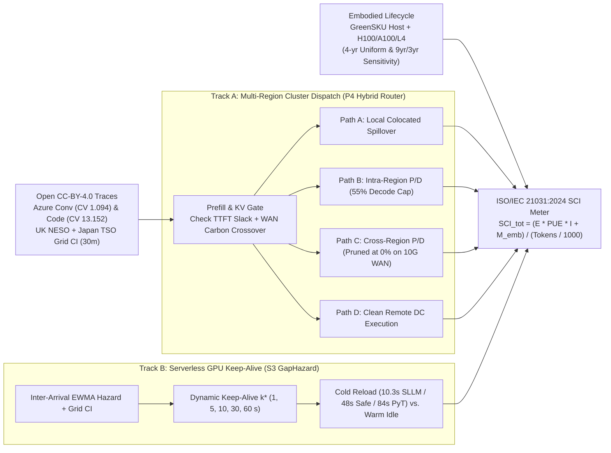
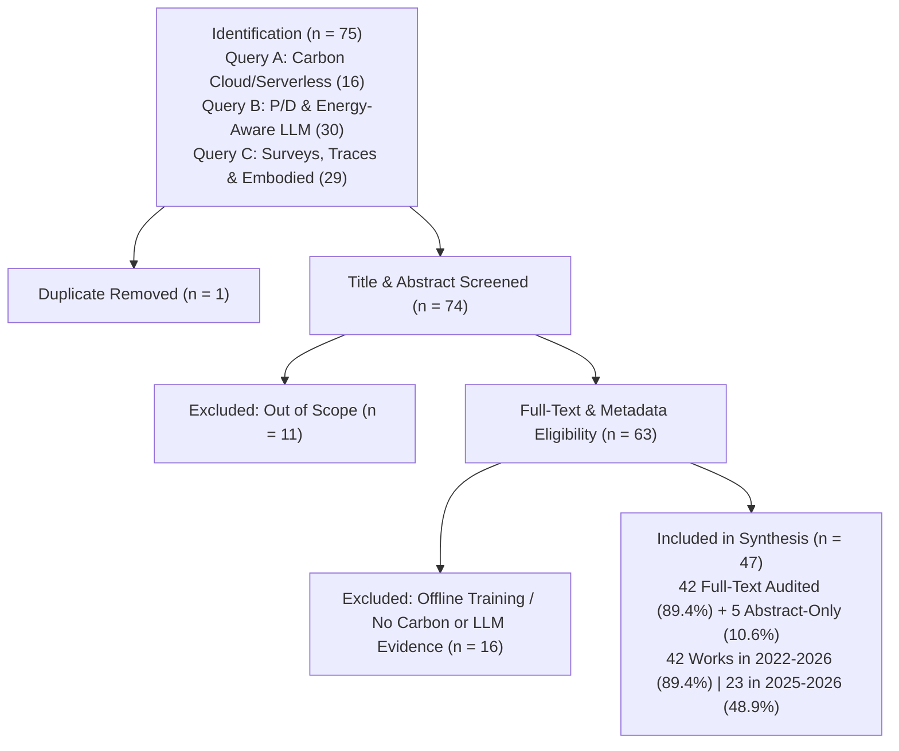

# Carbon-Aware Scheduling for Phase-Disaggregated LLM Inference in Cloud and Serverless Platforms: Review and Simulation

[](https://orcid.org/0009-0004-3968-4857)
[](./LICENSE)
[](https://creativecommons.org/licenses/by/4.0/)
[](./experiments/simulator.py)
[](./main.pdf)

**Author:** **Umar Iqbal**  
**Affiliation:** IILM University, Greater Noida, India  
**Email:** [umar.iqbal.cs28@iilm.edu](mailto:umar.iqbal.cs28@iilm.edu) · **ORCID:** [https://orcid.org/0009-0004-3968-4857](https://orcid.org/0009-0004-3968-4857)

---

## Abstract & Core Problem

Interactive Large Language Model (LLM) serving splits into two asymmetric phases: compute-bound **prefill** (governed by Time-To-First-Token, TTFT) and memory-bandwidth-bound **decode** (governed by Time-Per-Output-Token, TPOT) linked by a large Key-Value (**KV**) cache. Meanwhile, cloud carbon-aware schedulers optimize across clean/dirty regional electricity grids without modeling multi-megabyte KV WAN transfer costs, LLM phase separation, multi-gigabyte GPU checkpoint cold starts (`10.3–84.0 s`), or hardware manufacturing (**embodied**) carbon.

This repository archives the complete single-author paper ([`main.pdf`](./main.pdf)), Overleaf source bundle ([`cloud-paper.zip`](./cloud-paper.zip)), PRISMA-2020 systematic literature review (`47` retained works), and deterministic `SimPy 4.1.2` simulation suite (`226` configurations × `10` paired seeds = `2,260` runs) driven by open **CC-BY-4.0** Azure LLM traces, UK NESO carbon telemetry, Japan FY2024 TSO grid factors, and Azure GreenSKU hardware carbon tables.

---

## System Architecture

### Dual-Track Control Plane (`Track A` Cluster + `Track B` Serverless -> `ISO/IEC 21031:2024 SCI`)




---

## PRISMA-2020 Systematic Review & Gap Audit



<p align="center">
  
  
</p>

| Structural Gap Identified | Observed Count | Key Implication |
|---|---:|---|
| Phase-disaggregated LLM engines integrating Grid CI or Embodied Carbon | **`0 / 6`** | Engine governors optimize local Watts/Joules on single grids only |
| Multi-region cloud carbon schedulers modeling LLM P/D or KV WAN cost | **`0 / 4`** | Unconditional geo-routing collapses under `625 MB`-scale WAN KV transfers |
| Reviewed studies omitting hardware manufacturing (embodied) carbon | **`37 / 47` (`78.7%`)** | Misses factory carbon dominance (`93.0%–97.6%`) on wind-clean grids |
| Empirical evaluations testing live multi-continent disaggregated LLMs | **`0`** | `40.0%` single-site clusters, `28.6%` hybrid, `25.7%` sim-only, `5.7%` abstract-only |


---

## Key Simulation Results (`2,260` `SimPy 4.1.2` Runs, `10` Paired Seeds)

### 1. Multi-Region Cluster Carbon–SLO Frontier (`E1`)
- **Conversational traffic (`conv`):** Hybrid router **`P4`** reduces operational SCI by **`60.8%`** (`1h`) and **`60.7%`** (`24h`)—and total lifecycle SCI by **`54.6%–54.9%`**—versus carbon-agnostic colocation `B1` (`p = 0.002`) while keeping SLO violations at **`0.81%–0.82%`** (well inside the `5%` SLA ceiling).
- **Bursty code traffic (`code`, `CV = 13.152`):** Unconditional geographic routing **`P3`** suffers WAN KV stalls (`44.45%–44.57%` SLO violations, `30.7–39.3 s` P95 TTFT). **`P4`** automatically prunes cross-region KV forwarding (`Path C = 0%`) and cuts tail SLO violations by **`85.2%–86.0%`**, tracking the 30-minute future-seeing oracle **`P5`** within **`0.02%`** carbon.


### 2. Serverless GPU Keep-Alive Inversion (`E2` & `SW4`)
- **Dirty Grid (`TEPCO`, `581.6 gCO2eq/kWh`):** `GapHazard` (**`S3`**) cuts operational carbon by **`8.0%`** vs. `0 s` (`S1`), `7.0%` vs. `30 s` (`S2`), and `11.0%` vs. `60 s` (`S2b`, `p = 0.002`), trading faster eviction for `28.60%` cold-start SLO violations. Under slower 70B loaders, **`S3`** saves **`23.7%`** (`84 s` PyTorch) to **`30.9%`** (`48 s` Safetensors) operational carbon.
- **Clean Wind Grid (`South Scotland`, `9.75 gCO2eq/kWh`):** Because operational emissions are negligible, **`S3`** extends warm retention selectively, cutting SLO violations by **`32.6%`** vs. `30 s` timeout (`12.99%` vs. `19.29%`, `p = 0.002`).


### 3. Stress Tests & The Clean Scale-Out Paradox (`SW1–SW3`, `H4`)
- **Extreme `3.0x` Load (`SW1`) & Tiered `L4` Decode (`SW3`):** **`P4`** maintains **`2.89%`** SLO violations at `3.0x` load (vs. `71.94%` under `P3` and `54.48%` under `B1`) and **`0.76%`** on memory-constrained `L4` decode nodes (vs. `53.47%` under `P3`).
- **Embodied Scale-Out Paradox (`H4`):** In wind-clean `South Scotland`, embodied manufacturing accounts for **`93.0%`** (cluster) to **`97.6%`** (serverless) of total lifecycle SCI. Adding **4 spare clean-region nodes** (`10` vs. `6`) lowers operational carbon slightly (`0.00837 -> 0.00804`) but **raises total lifecycle carbon by `+32.6%` (`4-yr` life) and `+27.7%` (`9-yr` host / `3-yr` GPU life)**.


---

## Repository Layout

```text
.
├── LICENSE                   # MIT License (code); README notes CC-BY-4.0 for text/notes/data
├── README.md                 # Project overview, Mermaid diagrams, result figures, and repro guide
├── main.pdf                  # Compiled 13-page paper PDF
├── main.tex                  # Master IEEEtran LaTeX manuscript
├── references.bib            # 47 verified BibTeX references
├── cloud-paper.zip           # Self-contained Overleaf upload bundle
├── assets/                   # Rendered PNG previews (fig1–fig7) for GitHub README display
├── sections/                 # Section LaTeX sources (01_introduction.tex – 08_conclusion.tex)
├── figures/                  # Vector PDF figures (fig1–fig7), icons, and generate_figures.py
├── experiments/
│   ├── sim_config.py         # Hardware, grid, SLO, and sweep configurations
│   ├── trace_loader.py       # CC-BY-4.0 Azure, UK NESO, and Japan TSO loaders
│   ├── simulator.py          # SimPy 4.1.2 discrete-event cluster & serverless engine
│   ├── run_experiments.py    # Executes all 226 configs × 10 paired seeds (2,260 runs)
│   ├── analyze_results.py    # Student-t 95% CIs, paired Wilcoxon tests, H1–H4 verdicts
│   ├── parameter_sources.json# Documented hardware & latency provenance
│   ├── DESIGN.md             # Simulation design & hypothesis specification
│   ├── data/                 # Open CC-BY-4.0 traces & DATA_MANIFEST.md
│   └── results/              # All 21 raw, summary, and statistical CSV files
├── research/                 # PRISMA logs, sources.csv, comparison matrix, notes/, audit reports
├── BLOCKERS.md               # Transparent log of paywalled/blocked resources (never bypassed)
├── SETUP_LOG.md              # Local toolchain and verification log
└── SUBMISSION_NOTES.md       # Target venues, cover letter draft, and pre-submission checklist
```

---

## Reproducing Everything Locally

### 1. Create Environment & Install Packages
Requires **Python 3.10+**:
```bash
python -m venv .venv
# Windows: .venv\Scripts\activate
# Linux/macOS: source .venv/bin/activate
pip install simpy numpy pandas scipy matplotlib seaborn requests bibtexparser pybtex pillow
```

### 2. Run the Full Simulation & Statistical Verification
```bash
python experiments/run_experiments.py
python experiments/analyze_results.py
```

### 3. Regenerate Vector Figures
```bash
python figures/generate_figures.py
```

### 4. Compile the LaTeX Paper
```bash
latexmk -pdf -interaction=nonstopmode main.tex
```
Alternatively, upload [`cloud-paper.zip`](./cloud-paper.zip) directly to **Overleaf** using **`pdfLaTeX`**.

---

## Datasets & Attribution

All external workload and electricity grid traces are openly licensed under **CC-BY-4.0** (full provenance in [`experiments/data/DATA_MANIFEST.md`](./experiments/data/DATA_MANIFEST.md)):
- **Microsoft Azure LLM Inference Trace & GreenSKU Carbon Data:** `Azure/AzurePublicDataset` and Zenodo [`doi:10.5281/zenodo.10896254`](https://doi.org/10.5281/zenodo.10896254).
- **UK Regional Grid Carbon Intensity (Oct 2025):** [UK NESO Carbon Intensity API](https://api.carbonintensity.org.uk).
- **Japan FY2024 TSO-Level CO2 Emission Factors:** Zenodo [`doi:10.5281/zenodo.18396311`](https://doi.org/10.5281/zenodo.18396311).

---

## Citation

If you use this simulator, PRISMA audit matrix, or findings, please cite:

```bibtex
@unpublished{iqbal2026carbon,
  author = {Umar Iqbal},
  title  = {Carbon-Aware Scheduling for Phase-Disaggregated LLM Inference in Cloud and Serverless Platforms: Review and Simulation},
  note   = {IILM University, Greater Noida, India; code and artifacts at \url{https://github.com/UmarIqbal000/carbon-aware-llm-scheduling}},
  year   = {2026}
}
```

---

## License

- **Simulation, Analysis & Plotting Code (`experiments/*.py`, `figures/*.py`):** Licensed under the [**MIT License**](./LICENSE) (`Copyright (c) 2026 Umar Iqbal`).
- **Manuscript Text, Figures & PRISMA Synthesis Artifacts (`sections/`, `figures/*.pdf`, `assets/`, `research/`):** Licensed under [**Creative Commons Attribution 4.0 International (CC BY 4.0)**](https://creativecommons.org/licenses/by/4.0/), compatible with all upstream `CC-BY-4.0` datasets.
